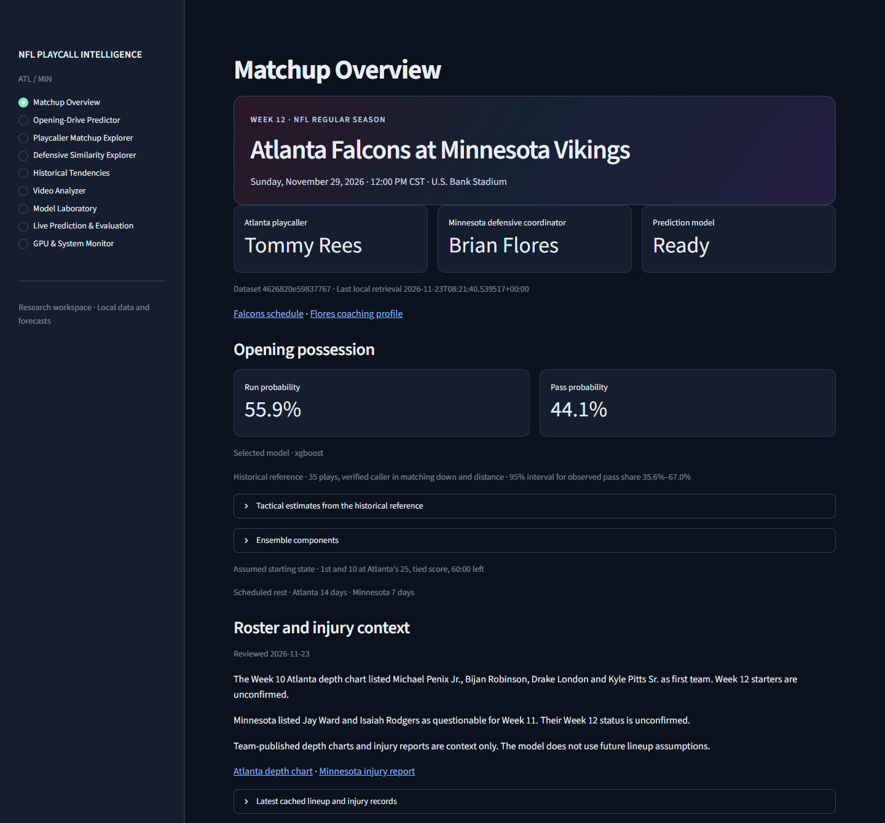

# NFL Playcall Intelligence

Estimate Atlanta’s next run or pass on its opening possession against Minnesota. The dashboard uses real NFL games, shows the evidence for each estimate and preserves the original pregame forecast when the operator logs actual plays.

**Target game:** Atlanta at Minnesota, November 29, 2026 at noon Central in U.S. Bank Stadium. Tommy Rees calls Atlanta’s offense. Brian Flores coordinates Minnesota’s defense. The verified caller history contains zero previous direct matchups. [Team schedule](https://www.atlantafalcons.com/schedule/2026/) · [Source records](DATA_SOURCES.md)



## Run on Windows

Use Python 3.12. These commands install the public project, download five seasons and train the local model. The first refresh needs internet access. Later launches can use the local cache.

```powershell
git clone https://github.com/Soham-Padalkar/nfl-playcall-intelligence.git
cd nfl-playcall-intelligence
code .
py -3.12 -m venv .venv
.\.venv\Scripts\Activate.ps1
python -m pip install -r requirements.txt
python -m playcall.refresh --seasons 2022 2023 2024 2025 2026
python -m playcall.refresh --train
python -m pytest -q
streamlit run app.py
```

If activation is unavailable, use `.\.venv\Scripts\python.exe` in place of `python` and launch with `.\.venv\Scripts\python.exe -m streamlit run app.py`. Open the local address printed by Streamlit. The sidebar has nine pages. Start with **Opening-Drive Predictor** to explore other starting positions. Freeze a scenario before kickoff. Use **Live Prediction & Evaluation** to record subsequent actual plays against that snapshot.

## Training and evaluation

DuckDB reads the local nflverse Parquet cache. The model labels a quarterback dropback, including a scramble or sack, as a pass decision. It excludes spikes, kneels and kicks. The candidate models use pre-snap inputs. Archived personnel and charting labels support separate tactical estimates.

The tabular experiment fits 2022–23, selects models and calibration on 2024, and tests once on 2025–26 through November 22. On **5,700 held-out opening-drive decisions in 447 games**, XGBoost achieved **66.93% accuracy**, **0.5838 log loss** and **0.2023 Brier score**. The down/distance/field-position baseline had 0.6004 log loss. This comparison measures decisions given the observed state. Correctly forecasting every play and outcome of an entire drive is a different test. See [MODEL_CARD.md](MODEL_CARD.md) for the Atlanta subset, scheme comparison and limits.

The tree combines play probabilities with empirical yardage and turnover distributions. It retains the highest-probability paths, reports discarded probability and stops on drive-ending outcomes. It models 30 seconds per simulated decision. The user can enter the actual time used in live mode. Pre-game scenarios and adaptive observations are separate immutable records under `data/predictions`.

## RTX 5060 and video

First inspect the driver and GPU. The tested Windows laptop used driver 573.22, compute capability 12.0 and 8,151 MiB of VRAM. Use the following optional GPU setup with the project's Python 3.12 environment active.

```powershell
nvidia-smi
python -m pip install torch==2.7.1 torchvision==0.22.1 --index-url https://download.pytorch.org/whl/cu128
python -m playcall.gpu
python -m playcall.neural --batch-size 128 --accumulation-steps 2 --report models/neural-results.json
```

The tensor check should report the execution device and the product `[[1, 3], [3, 13]]`. The dashboard and conventional models run on the CPU. The video analyzer accepts local authorized clips. OpenCV provides an offline person detector. The optional MobileNet Faster R-CNN detector downloads its pretrained weights on first use. The analyzer returns sampled frames, boxes, short tracks and candidate lines for manual review. Track motion is measured in image pixels. Camera motion, cuts and occlusion affect these measurements. [Official PyTorch builds](https://pytorch.org/get-started/previous-versions/)

## Data updates

`python -m playcall.refresh --train --freeze-updates` checks the source cache, compares training inputs and saves a new scenario when retraining occurs before kickoff. Existing scenarios retain their original data and model version. To install the local Windows task, run:

```powershell
.\scripts\register-refresh.ps1
Get-ScheduledTaskInfo -TaskName 'NFL Playcall Intelligence - refresh'
```

The local task runs at 6 a.m. through December 1, 2026. It requires this checkout and its virtual environment to stay at the registered path. A new clone has no scheduled task until registration. To remove the task, use `Unregister-ScheduledTask -TaskName 'NFL Playcall Intelligence - refresh'`. The app records manual verification dates for coaches and the schedule. Review those sources if duties or kickoff change.

## Troubleshooting

| Symptom | Action |
| --- | --- |
| Python launcher cannot find 3.12 | Install 64-bit CPython 3.12 or use `uv venv .venv --python 3.12 --seed`. |
| CUDA unavailable | Run `nvidia-smi`, verify the active Python path and install the CUDA wheel above. Run the tensor test again. |
| GPU memory exhausted | Reduce batch size or frame count. Increase gradient accumulation for neural training, or select CPU. |
| Dependency conflict | Use a clean 3.12 environment, install the requirements and run `python -m pip check`. |
| Model missing or incompatible | Run the refresh and training commands. Load only checkpoints produced by a trusted local run. |
| GitHub access | Public cloning and data downloads need no token. Maintainers can check publishing access with `gh auth status`. |
| Port in use | Run `streamlit run app.py --server.port 8502`. |
| Optional source missing | See the source table for availability, then refresh after the publisher releases the data. |

[Architecture](ARCHITECTURE.md) · [Development and routing](AGENTS.md) · [Implementation status](PROJECT_STATUS.md) · [Data sources](DATA_SOURCES.md) · [Release notes](CHANGELOG.md)

## Frozen-drive test and release artifacts

### Update a prediction from the visible setup

In **Opening-Drive Predictor**, expand **Update from the visible setup**. Enter the quarterback alignment and personnel groups. Use two digits for offensive personnel, such as 12 for one running back and two tight ends. Enter defensive personnel as linemen, linebackers and defensive backs, such as 4-2-5. Enter up to three previous calls by that offense in the same game, oldest first. The same panel on **Live Prediction & Evaluation** uses the selected game log as its source of prior calls.

The pre-snap backtest got 71.40% of all eligible calls right. Its high-confidence group reached 94.07% accuracy on 8.58% of plays. Reproduce the comparison with `python -m playcall.presnap`. [Pre-snap results](docs/presnap-results.json)

Across 27 held-out Atlanta opening drives, a separate frozen replay predicted the first call correctly 15 times. A league first-call baseline was correct 18 times. Run `python -m playcall.replay --as-of 2026-11-23 --output models/replay-results.json` to reproduce this comparison. The release includes the [tabular evaluation](docs/backtest.json), [frozen-drive evaluation](docs/replay-results.json), [GPU experiment](docs/neural-results.json), [cloud training notebook](notebooks/neural-opening-drive.ipynb) and [predictor screenshot](docs/opening-drive-predictor.png).
